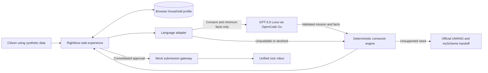
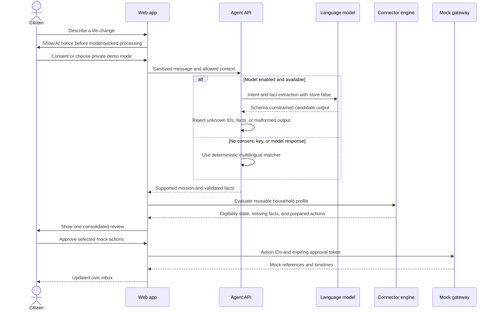
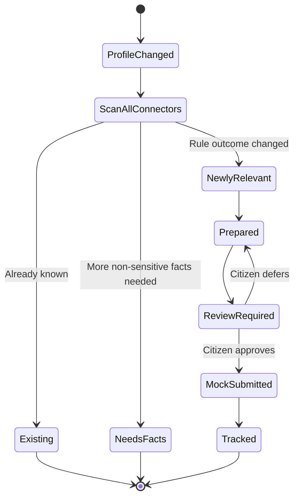

# RightNow India Architecture

## Product boundary

RightNow India is an independent prototype that demonstrates a simpler way to access public services. It is not a government website, is not endorsed by any government department, and never connects to live identity, payment, OTP, document, or application systems.

The demonstration uses synthetic household data and mocked submissions. Official links are provided for information and safe handoff only.

## Design principle

The citizen describes a life change once. RightNow India then:

1. Recognizes a supported life mission.
2. Asks only for non-sensitive facts that have not already been provided.
3. Evaluates service readiness with deterministic connector rules.
4. Prepares every relevant mock action.
5. Requests one consolidated approval.
6. Creates clearly marked mock reference numbers and status updates.
7. Rechecks all connectors when the reusable household profile changes.

The model may interpret language and extract allowed facts. It cannot decide eligibility, invent services, or submit an action.

## System context



## Request and decision flow



## Main components

| Component | Responsibility | Trust boundary |
| --- | --- | --- |
| Conversation shell | Mission prompts, text or voice input, adaptive questions, review, and inbox | Treats all input as untrusted |
| Household profile | Stores reusable, non-sensitive facts in the browser | Local-only state with a permanent clear action |
| Agent API | Detects language, maps intent, and extracts only allowed facts | Validates all requests and model output with schemas |
| Provider adapter | Calls a Responses-compatible AI endpoint | Server-only API key, minimum facts, `store: false` where supported |
| Connector engine | Produces factual readiness and preparation outcomes | Deterministic code is the sole eligibility authority |
| Household autopilot | Re-evaluates every connector after a profile update | Adds newly relevant actions without submitting them |
| Mock gateway | Verifies approval and generates mock status timelines | Accepts known prepared-action IDs only |
| Civic inbox | Tracks prepared, submitted, completed, deadline, and renewal states | Clearly labels all demonstration records as mock |

## Connector contract

```ts
interface ServiceConnector {
  id: ServiceId;
  missionIds: MissionId[];
  requiredFacts: FactKey[];
  evaluate(profile: HouseholdProfile): EligibilityResult;
  prepare(profile: HouseholdProfile): PreparedAction;
  sources: OfficialSource[];
  lastVerified: string;
}
```

Unknown mission IDs, service IDs, fact keys, and model-generated conclusions are rejected at the schema boundary. Connectors return an explicit state such as `eligible`, `needs_information`, or `not_eligible`, with a user-facing reason and official source.

## Demonstration connector catalogue

| Mission | Mock connectors |
| --- | --- |
| Pregnancy | PMMVY, JSY, JSSK, birth registration preparation |
| College | National Scholarship Portal readiness, DigiLocker readiness, Academic Bank of Credits readiness |
| First work or remote income | PAN readiness, income tax readiness, EPFO readiness, ESIC readiness |
| Job loss | EPFO claim preparation, ESIC assistance readiness, National Career Service |
| Small business | Udyam readiness, GST readiness, PMEGP or MUDRA discovery |
| Public-service problem | CPGRAMS preparation, National Consumer Helpline preparation |

This is a reusable architecture demonstrated through six missions and nineteen mock connectors. It is not a claim that every public service is already supported.

## Runtime AI adapter

The optional model-backed configuration is:

```env
AI_PROVIDER=opencode-go
AI_BASE_URL=https://opencode.ai/zen/go/v1
AI_MODEL=gpt-5.6-luna
AI_API_KEY=<server-only deployment secret>
```

The server calls the provider's Responses-compatible endpoint. Product logic depends on an internal adapter rather than a provider-specific response shape, so the language layer can be changed without changing connector rules.

The deterministic mission matcher remains available when consent is declined, a key is missing, the request times out, or the returned schema is invalid.

The first public Vercel deployment intentionally omits `AI_API_KEY` and runs in deterministic mode. The in-process rate limiter is only defense-in-depth because serverless instances do not share memory. A durable Vercel Firewall, Vercel KV, Upstash or equivalent rate limit is required before enabling the paid runtime provider.

## Household autopilot



Autopilot is preparation-only. A profile change can discover or prepare an action, but it cannot authorize submission.

## Privacy and security controls

- Synthetic data is required for the public demonstration.
- The first model-backed message requires a short processing notice.
- The interface tells users not to enter identity numbers, records, OTPs, or payment details.
- Household state stays in browser storage and can be cleared at any time.
- API keys are server-only environment variables and are excluded from the repository.
- The AI request contains the minimum mission-selection context.
- Model output passes schema validation and cannot supply an eligibility result.
- The gateway accepts only prepared IDs and an expiring consolidated-approval token.
- No live government, identity, payment, OTP, or document API is called.
- Error messages avoid exposing provider details, secrets, or request payloads.

## Accessibility and resilience

- Keyboard-reachable controls with visible focus states
- Semantic headings, labels, status regions, and dialog behavior
- Minimum 44 pixel interactive targets on touch layouts
- English, Hindi, and Tamil mission recognition in the deterministic fallback
- Mobile-first responsive layout with dark mode and reduced-motion support
- Explicit loading, empty, validation, offline, and provider-fallback states
- Text input remains available when browser speech recognition is unsupported

## Deployment boundary

The Next.js application can be deployed to Vercel. Only the server runtime receives AI and mock-gateway secrets. The browser receives no provider key. The first public smoke test runs with the AI provider disabled because deterministic fallback is a required product behavior; runtime AI is enabled only after durable distributed rate limiting is configured.
