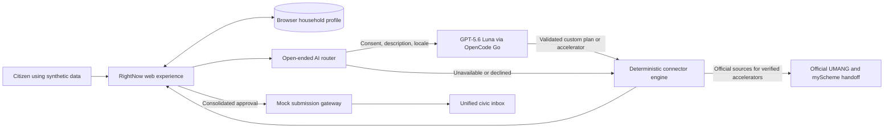
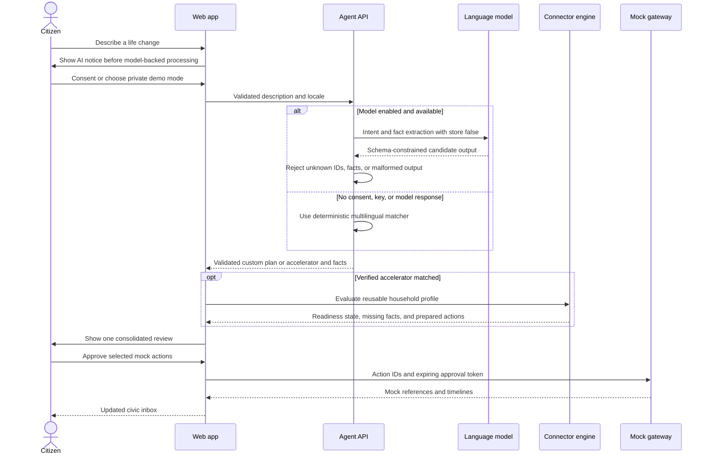
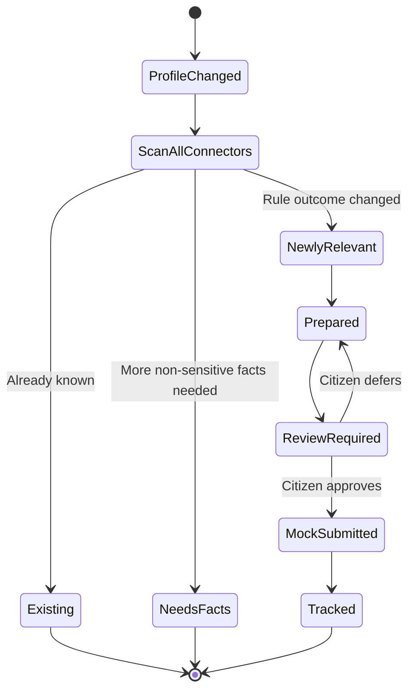

# RightNow India Architecture

## Product boundary

RightNow India is an independent prototype that demonstrates a simpler way to access public services. It is not a government website, is not endorsed by any government department, and never connects to live identity, payment, OTP, document, or application systems.

The demonstration uses synthetic household data and mocked submissions. Official links are provided for information and safe handoff only.

## Design principle

The citizen describes a life change once. RightNow India then:

1. Routes any safe description into a bounded simulation plan.
2. Uses a verified accelerator when one confidently matches.
3. Asks only for non-sensitive facts that have not already been provided.
4. Evaluates accelerator readiness with deterministic connector rules.
5. Requests an explicit review before recording anything.
6. Creates clearly marked mock reference numbers and status updates.

The model may interpret language and generate open-ended preparation steps. It cannot decide official eligibility, claim a real integration, or submit an action.

## System context



## Request and decision flow



## Main components

| Component | Responsibility | Trust boundary |
| --- | --- | --- |
| Conversation shell | Open text or voice input, example prompts, adaptive questions, review, and inbox | Treats all input as untrusted |
| Household profile | Stores reusable, non-sensitive facts in the browser | Local-only state with a permanent clear action |
| Agent API | Detects language, builds a custom plan, or maps to a verified accelerator | Validates all requests and model output with schemas |
| Provider adapter | Calls the pinned OpenCode Go Responses-compatible endpoint | Server-only API key, explicit consent, `store: false`, strict output validation |
| Connector engine | Produces factual readiness and preparation outcomes | Deterministic code is the sole eligibility authority |
| Mock gateway | Verifies an expiring approval token and generates mock status timelines | Accepts allowlisted mock action IDs only; has no external side effects |
| Civic inbox | Tracks approved simulation records and their mock timelines | Clearly labels all demonstration records as mock |

## Connector contract

```ts
interface ServiceConnector {
  id: ServiceId;
  missionIds: MissionId[];
  requiredFacts: FactKey[];
  evaluate(profile: HouseholdProfile): EligibilityResult;
  prepare(profile: HouseholdProfile): PreparedAction;
  sources: OfficialSource[];
  lastVerified: string;
}
```

Unknown mission IDs, service IDs, fact keys, and model-generated conclusions are rejected at the schema boundary. Connectors return an explicit state such as `eligible`, `needs_information`, or `not_eligible`, with a user-facing reason and official source.

## Demonstration connector catalogue

| Mission | Mock connectors |
| --- | --- |
| Pregnancy | PMMVY, JSY, JSSK, birth registration preparation |
| College | National Scholarship Portal readiness, DigiLocker readiness, Academic Bank of Credits readiness |
| First work or remote income | PAN readiness, income tax readiness, EPFO readiness, ESIC readiness |
| Job loss | EPFO claim preparation, ESIC assistance readiness, National Career Service |
| Small business | Udyam readiness, GST readiness, PMEGP or MUDRA discovery |
| Public-service problem | CPGRAMS preparation, National Consumer Helpline preparation |

The connector catalogue is a set of deeper verified accelerators, not the boundary of the conversational product. Open-ended requests receive generated simulation plans; they are not presented as verified public-service procedures.

## Runtime AI adapter

The optional model-backed configuration is:

```env
AI_PROVIDER=opencode-go
AI_BASE_URL=https://opencode.ai/zen/go/v1
AI_MODEL=gpt-5.6-luna
AI_API_KEY=<server-only deployment secret>
```

The server calls the provider's Responses-compatible endpoint. Product logic depends on an internal adapter rather than a provider-specific response shape, so the language layer can be changed without changing connector rules.

The deterministic mission matcher remains available when consent is declined, a key is missing, the request times out, or the returned schema is invalid. Unmatched requests still receive a generic, explicitly labeled fallback simulation.

An AI-enabled public deployment requires `AI_API_KEY` plus durable rate limiting. The in-process limiter is defense-in-depth only because serverless instances do not share memory.

## Household autopilot



Autopilot is preparation-only. A profile change can discover or prepare an action, but it cannot authorize submission.

## Privacy and security controls

- Synthetic data is required for the public demonstration.
- The first model-backed message requires a short processing notice.
- The interface tells users not to enter names, exact addresses, identity numbers, personal records, OTPs, or payment details.
- Household state stays in browser storage and can be cleared at any time.
- API keys are server-only environment variables and are excluded from the repository.
- The AI request contains the accepted description and locale. RightNow warns people not to include personal or sensitive details and blocks common identifier patterns, but this is not complete redaction.
- Model output passes schema validation plus a semantic safety gate for invented outcomes, fees, deadlines, links, identifiers, and medical dosing. It cannot supply a connector eligibility result.
- The mock gateway accepts only allowlisted mock action IDs and a matching expiring approval token. It proves possession of that token, not a real government approval or side effect.
- No live government, identity, payment, OTP, or document API is called.
- Error messages avoid exposing provider details, secrets, or request payloads.

## Accessibility and resilience

- Keyboard-reachable controls with visible focus states
- Semantic headings, labels, status regions, and dialog behavior
- Minimum 44 pixel interactive targets on touch layouts
- English, Hindi, and Tamil mission recognition in the deterministic fallback
- Mobile-first responsive layout with dark mode and reduced-motion support
- Explicit loading, empty, validation, offline, and provider-fallback states
- Text input remains available when browser speech recognition is unsupported

## Deployment boundary

The Next.js application can be deployed to Vercel. Only the server runtime receives AI and mock-gateway secrets. The browser receives no provider key. Smoke-test both AI-enabled and provider-unavailable paths; runtime AI is enabled only after durable distributed rate limiting is configured.
