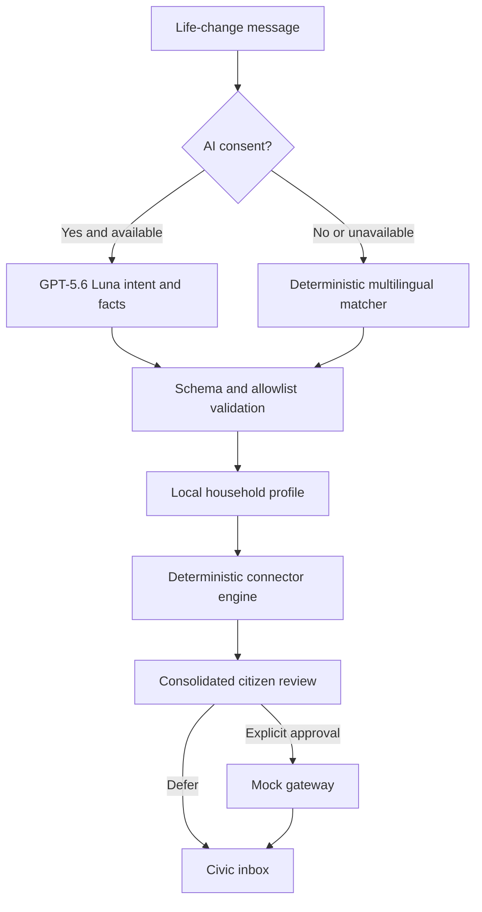

# RightNow India: Built with Codex

## Public build record

This document is a sanitized record of how Codex helped build and review RightNow India. It contains no API keys, personal data, real identity numbers, private conversation excerpts, or real application records.

RightNow India is an independent prototype. It is not a government website and is not government-endorsed. Every application, document state, reference number, and timeline shown in the demo is synthetic or mocked.

## Problem translated into a product

The starting problem was not simply that government websites can be difficult to navigate. The deeper problem was that citizens often do not know which department, scheme, entitlement, or form applies after a life change.

Codex helped turn that problem into five product decisions:

1. Begin with a life change, not a department list.
2. Reuse one household profile across services.
3. Keep eligibility in deterministic connector rules.
4. Prepare multiple relevant actions, then request one approval.
5. Keep a unified inbox for applications, deadlines, renewals, and newly discovered benefits.

## Sanitized decision timeline

| Stage | Codex contribution | Builder decision | Evidence |
| --- | --- | --- | --- |
| Problem framing | Compared a narrow service redesign with an all-in-one civic assistant | Choose an independent, UMANG-like mission model rather than a transport or single-form product | Product scope and six missions |
| Architecture | Separated language interpretation, eligibility rules, preparation, approval, and mock submission | The model may extract intent and facts but may not decide eligibility | `docs/architecture.md` and connector contract |
| Risk boundary | Identified identity, payment, OTP, sensitive-data, and endorsement risks | Use synthetic data and no live government APIs | Persistent disclosure and mock gateway |
| Test design | Defined unit, integration, multilingual, failure, and end-to-end scenarios before implementation | Prioritize six complete journeys over a larger shallow catalogue | Test files and verification report |
| Implementation | Generated the schema-driven engine, provider adapter, frontend, local profile, review, and inbox | Keep the experience conversational and mobile-first | Source tree and running prototype |
| Source review | Collected official entry points for demonstrated services | Link users to official sources and avoid claiming legal certainty | Source table below |
| Accessibility | Reviewed keyboard, focus, status, contrast, reduced motion, and fallback behavior | Text must remain fully usable without voice or AI | Accessibility checklist |
| Security | Checked for client-side secrets, unvalidated model output, live submissions, and sensitive identifiers | Server-only key, schema validation, minimum facts, explicit consent | Environment example, API boundaries, security review |
| Delivery | Prepared submission copy and a two-minute walkthrough | Show citizen value in minute one and Codex evidence in minute two | `docs/submission-summary.md` and `docs/demo-script.md` |

## Selected sanitized prompt-to-result examples

These are paraphrased public examples, not verbatim private conversation.

| Sanitized prompt | Codex result | Builder review |
| --- | --- | --- |
| "Design one reusable contract for services across six life missions." | A connector interface with required facts, deterministic evaluation, preparation, official sources, and verification dates | Accepted because new services can be added without changing the conversation shell |
| "Test pregnancy outcomes before implementing the rules." | Cases for missing facts, relevant outcomes, not-relevant outcomes, and consistent preparation | Accepted with synthetic fixtures only |
| "Make model output unable to create eligibility decisions." | A strict allowlist for mission IDs and fact keys, with eligibility excluded from the model schema | Accepted as a core safety boundary |
| "Keep the demo useful when AI is unavailable or declined." | English, Hindi, and Tamil deterministic intent matching plus guided mission prompts | Accepted as both a privacy option and resilience feature |
| "Turn several prepared services into one understandable decision." | A consolidated review with per-action reasons, document checklists, and a single mock approval | Accepted with no automatic submission |
| "Show how Codex was used without exposing private work." | A public architecture page, sanitized timeline, prompt-to-result table, test evidence, and responsibility split | Accepted with private excerpts and secrets excluded |

## What Codex produced and what the builder decided

| Codex produced | Builder decided |
| --- | --- |
| Product alternatives, risk analysis, and implementation breakdown | The final citizen problem, name, scope, and success criteria |
| Connector types, deterministic evaluation structure, and household autopilot logic | Which six missions were important enough for the demo |
| Frontend components, API routes, mocked gateway, and tests | The final tone, interaction order, and what appears in the two-minute video |
| Multilingual fallback and provider-adapter implementation | Whether AI processing is enabled in the deployment |
| Accessibility, code-quality, and security review findings | Which tradeoffs to accept under the hackathon deadline |
| Public documentation and draft submission materials | Final verification, deployment, recording, and submission |

Codex did not choose eligibility policy, submit applications, handle real identity data, or replace official service guidance.

## Architecture evidence

## Official-source verification

The service rules in the prototype are simplified demonstration logic, not legal advice or a guarantee of eligibility. A connector-specific review must be completed before marking any row final.

| Demonstrated connector | Official entry point | Verification status on 2026-08-28 |
| --- | --- | --- |
| PMMVY | [Ministry of Women and Child Development FAQ](https://www.spniwcd.wcd.gov.in/pradhan-mantri-matru-vandana-yojna/faqs) | Official page located, detailed rule review pending final check |
| JSY | [National Health Mission](https://www.nhm.gov.in/index1.php?lang=1&level=3&lid=309&sublinkid=841) | Official page located, detailed rule review pending final check |
| JSSK | [National Health Mission](https://www.nhm.gov.in/index4.php?lang=1&level=0&lid=171&linkid=150) | Official page located, detailed rule review pending final check |
| Birth registration preparation | [Civil Registration System](https://crsorgi.gov.in/) | Official entry point selected, state-specific handoff review pending |
| Scholarship readiness | [National Scholarship Portal](https://scholarships.gov.in/) | Official entry point selected, scheme-specific rule review pending |
| DigiLocker readiness | [DigiLocker](https://www.digilocker.gov.in/) | Official entry point selected, connector copy review pending |
| Academic document readiness | [Academic Bank of Credits](https://www.abc.gov.in/) | Official entry point selected, connector copy review pending |
| PAN readiness | [Income Tax Department](https://www.incometax.gov.in/iec/foportal/help/how-to-generate-instant-e-pan) | Official page selected, connector copy review pending |
| Income tax readiness | [Income Tax Department filing help](https://www.incometax.gov.in/iec/foportal/help/all-topics/e-filing-services/file-itr-2-online) | Official page located, simplified demo rule review pending |
| EPFO readiness | [Employees' Provident Fund Organisation](https://www.epfindia.gov.in/site_en/For_Employees.php) | Official entry point selected, connector copy review pending |
| ESIC readiness | [Employees' State Insurance Corporation](https://www.esic.gov.in/) | Official entry point selected, connector copy review pending |
| EPFO claim preparation | [EPFO online services](https://www.epfindia.gov.in/site_en/Online_Services.php) | Official entry point selected, claim-specific rule review pending |
| ESIC assistance readiness | [Employees' State Insurance Corporation](https://www.esic.gov.in/) | Official entry point selected, benefit-specific rule review pending |
| National Career Service | [National Career Service](https://www.ncs.gov.in/) | Official entry point selected, connector copy review pending |
| Udyam readiness | [Udyam Registration](https://udyamregistration.gov.in/) | Official entry point selected, connector copy review pending |
| GST readiness | [Central Board of Indirect Taxes and Customs FAQ](https://cbic-gst.gov.in/faq.html) | Official page located, simplified threshold logic review pending |
| PMEGP discovery | [KVIC PMEGP portal](https://www.kviconline.gov.in/pmegpeportal/pmegponlineapp/) | Official entry point selected, discovery copy review pending |
| MUDRA discovery | [MUDRA](https://www.mudra.org.in/) | Official entry point selected, discovery copy review pending |
| CPGRAMS preparation | [Centralised Public Grievance Redress and Monitoring System](https://pgportal.gov.in/) | Official entry point selected, routing copy review pending |
| National Consumer Helpline preparation | [National Consumer Helpline](https://consumerhelpline.gov.in/) | Official entry point selected, routing copy review pending |
| Unsupported-service handoff | [UMANG](https://web.umang.gov.in/landing) and [myScheme](https://www.myscheme.gov.in/) | Official handoff entry points located, final link check pending |

## Test and verification evidence

| Check | Command or method | Result |
| --- | --- | --- |
| Unit and integration tests | `npm run test:coverage` | **PASS: 73 tests across 10 files** |
| Coverage | `npm run test:coverage` | **PASS: 93.58% statements, 88.71% branches, 100% functions, 94.95% lines** |
| Production build | `npm run build` | **PASS: Next.js production bundle compiled and all routes generated** |
| Type checking | `npm run typecheck` | **PASS: no TypeScript errors** |
| Lint | `npm run lint` | **PASS: no ESLint errors or warnings** |
| End-to-end journeys | `npm run test:e2e` | **PASS: 22 checks on Chromium desktop and iPhone 13 WebKit** |
| English, Hindi, Tamil parity | Automated deterministic fixtures | **PASS: pregnancy/work in English, job loss/grievance in Hindi, and college in Tamil map to their expected missions** |
| Keyboard and screen-reader labels | Manual browser and semantic locator review | **PASS: labelled controls, dialog names, live status and keyboard-reachable actions verified** |
| Mobile and desktop layouts | Browser matrix and Playwright | **PASS: desktop Chromium, iPhone 13 WebKit and 390 × 844 no-overflow check** |
| Dark mode and reduced motion | Manual browser review | **PASS: both media-query states retain readable content and usable controls** |
| Lighthouse accessibility | Lighthouse production run | **PENDING: record score and URL** |
| Lighthouse performance | Lighthouse production run | **PENDING: record score and URL** |
| Dependency audit | `npm audit --omit=dev` | **PASS: zero production vulnerabilities** |
| Security review | Reviewer threat-model pass | **PASS for deterministic deployment: no critical or high findings remain** |
| Secret scan | Repository and client-bundle review | **PASS: no production credentials or sensitive records found; test-only placeholders are isolated to tests** |
| Public smoke test | Deployed URL, AI on and deterministic fallback | **PENDING: record timestamp and result** |

## Final verification checklist

- [x] Six complete mission journeys are usable.
- [x] All demonstrated connectors have deterministic outcomes and source links.
- [x] AI output cannot provide eligibility decisions.
- [x] The experience works with AI disabled.
- [x] Consolidated approval is required before every mock submission.
- [x] All references and application records are visibly marked mock.
- [x] Household data can be cleared from the browser.
- [x] No real identifiers, documents, OTPs, payments, or government writes are present.
- [x] No API key is present in source, tests, logs, screenshots, or the client bundle.
- [ ] Coverage and Lighthouse results are copied from final runs, not estimated. Coverage is final; Lighthouse awaits the deployed URL.
- [x] The public page distinguishes Codex build-time work from GPT-5.6 Luna runtime interpretation.
